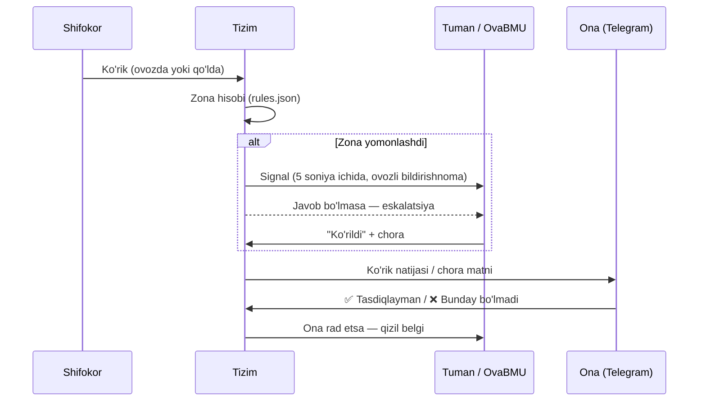
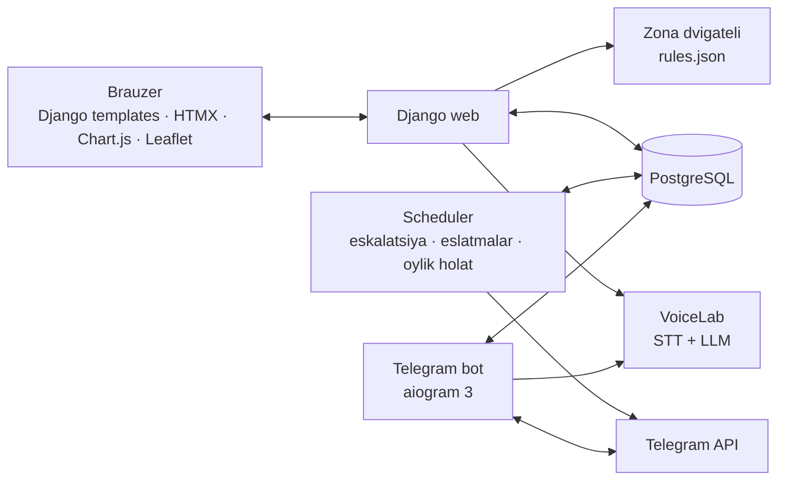

# Perinatal registr

**Yuqori xavf guruhidagi homilador ayollar va 0–2 yoshli bolalarni kuzatish tizimi.**

Tizim har bir homilador ayol va bolani ko'rik natijalariga qarab avtomatik ravishda **qizil / sariq / yashil** zonaga ajratadi. Holat yomonlashsa, tuman shifokori va OvaBMU (onalik va bolalikni muhofaza qilish) mutaxassislariga darhol signal yuboriladi. Signalga belgilangan vaqt ichida javob berilmasa, u avtomatik ravishda yuqori bosqichga ko'tariladi. Shifokor ko'rgan har bir chora onaning Telegramiga boradi va ona uni tasdiqlaydi.

   

---

## Mundarija

- [Muammo](#muammo)
- [Yechim](#yechim)
- [Asosiy imkoniyatlar](#asosiy-imkoniyatlar)
- [Rollar va ruxsatlar](#rollar-va-ruxsatlar)
- [Ish jarayoni](#ish-jarayoni)
- [Zona mantig'i](#zona-mantigi)
- [AI moduli](#ai-moduli)
- [Telegram bot](#telegram-bot)
- [Arxitektura](#arxitektura)
- [Loyiha tuzilmasi](#loyiha-tuzilmasi)
- [O'rnatish](#ornatish)
- [Sozlamalar](#sozlamalar)
- [Xavfsizlik va qonunchilik](#xavfsizlik-va-qonunchilik)
- [Ma'lumot manbalari](#malumot-manbalari)
- [Cheklovlar va rejalar](#cheklovlar-va-rejalar)

---

## Muammo

- Yuqori xavfli homiladorlar ko'pincha qog'oz jurnal va Excel jadvallarda kuzatiladi. Ayolning holati yomonlashsa, mutaxassis bundan kech xabar topadi.
- Homiladorlarning sezilarli qismi kech (12 haftadan keyin) ro'yxatga olinadi. Anemiya va gipertenziya kabi xavf belgilari o'z vaqtida aniqlanmaydi.
- Shifokor «chora ko'rildi» deb yozsa, buni hech kim tekshirmaydi.
- Rahbariyat qaysi hududda xavf ortib borayotganini oy oxiridagi hisobotdan, ya'ni kech biladi.

## Yechim

Tizim **yopiq halqa** tamoyili asosida ishlaydi:

```
Ko'rik  →  Zona hisobi  →  Signal  →  Eskalatsiya  →  Chora  →  Ona tasdig'i  →  O'lchash
(ovozda)   (qoidalar)     (5 s)      (javobsiz      (shifokor)  (Telegram)       (KPI)
                                      qolsa)
```

Tizim xavfni ko'rsatish bilan cheklanmaydi: chora ko'rilganini onaning o'zidan tasdiqlatadi va signalga javob vaqtini o'lchaydi.

**Kuzatuv davri: homiladorlikdan bola 2 yoshga to'lgunicha.** Bu JSST va UNICEFning «Birinchi 1000 kun» konsepsiyasiga mos keladi. Milliy emlash kalendarining bolalik qismi ham 16 oylik revaksinatsiya bilan tugaydi.

---

## Asosiy imkoniyatlar

| Yo'nalish | Imkoniyat |
|---|---|
| **Xavf zonalari** | Ona va bola uchun avtomatik zona. Har bir qaror sababi bilan chiqadi. Mavze, poliklinika, tuman va shahar zonasi ham hisoblanadi |
| **Signal va eskalatsiya** | Zona sariq bo'lsa, signal tuman shifokoriga, qizil bo'lsa OvaBMU va tuman shifokoriga boradi. Signal javobsiz qolsa, avtomatik yuqoriga ko'tariladi |
| **Ovozli ko'rik** | Shifokor ko'rikni o'zbek tilida gapiradi, AI 13 ta maydonni to'ldiradi, shifokor tasdiqlaydi |
| **AI xulosa** | Me'yorlar jadvaliga tayangan tibbiy xulosa: ko'rsatkichlar dinamikasi, xavflar va keyingi qadamlar |
| **Ona tasdig'i** | Har bir ko'rik natijasi va chora onaga boradi. Ona «✅ Tasdiqlayman» yoki «❌ Bunday bo'lmadi» tugmasini bosadi |
| **Antenatal reja** | 8 ta tashrif va 3 ta skrining. Kechikkan tashriflar belgilanadi |
| **Bola kuzatuvi** | Patronaj, birinchi yilda har oylik ko'rik, 1/3/6/12 oyda tor mutaxassislar, JSST o'sish medianalari |
| **Emlash** | Milliy kalendar (19 doza). Kasal bolani emlash bloklanadi. Emlash e'lon qilinganda bot 3 kun va 1 kun oldin eslatadi |
| **Patronaj** | Ko'rikka kelmaganlar ro'yxati va bir tugma bilan yuboriladigan eslatma |
| **Monitoring** | Xarita, oyma-oy dinamika, hududlar reytingi, statistika, ta'sir KPI'lari |
| **Interfeys** | O'zbek, rus va ingliz tillari, kun/tun rejimi, mobil ekranga moslashgan |

---

## Rollar va ruxsatlar

Barcha rollar bitta bazada ishlaydi, lekin har bir foydalanuvchi faqat o'z vakolatidagi ma'lumotni ko'radi. Ruxsatlar **serverda** tekshiriladi (`apps/accounts/scope.py`): boshqa hududdagi bemorning kartasini ochishga uringan foydalanuvchi 404 javobini oladi.

| Rol | Ko'rish doirasi | Nima qiladi |
|---|---|---|
| **Oilaviy shifokor** | O'z poliklinikasi | Homilador va bola ko'riklari, emlash, yo'llanma, signalga chora, AI xulosa, onaga xabar |
| **Akusher-ginekolog** | O'z poliklinikasi (homiladorlar) | Homiladorlarni ro'yxatga olish va antenatal ko'riklar |
| **Pediatr** | O'z poliklinikasi (bolalar) | Bola ko'riklari va emlash |
| **Patronaj hamshira** | Faqat o'z mavzesi | Uyga patronaj tashriflari, kelmaganlarga eslatma |
| **Tuman shifokori** | O'z tumani | Sariq signallar, eskalatsiya, yo'llanmalarni qabul qilish, poliklinika xodimlarini boshqarish |
| **OvaBMU** | Butun shahar | Qizil signallar, orderlar, shahar monitoringi, tuman shifokorlarini boshqarish |
| **Ona** (Telegram) | Faqat o'zi va farzandlari | Natijalarni ko'rish, choralarni tasdiqlash, xavf belgisini yuborish |

Bemor kartasini va ko'riklarni faqat bemor biriktirilgan poliklinika xodimlari tahrirlaydi. Tuman va OvaBMU ma'lumotni ko'radi hamda signal va yo'llanmalar bilan ishlaydi.

**Ierarxiya:** `Shahar → Tuman → Poliklinika → Mavze → Bemor`

---

## Ish jarayoni



---

## Zona mantig'i

Zonani AI emas, **shaffof qoidalar** belgilaydi. Qoidalar koddan alohida, [`rules.json`](rules.json) faylida saqlanadi. Fayl o'zgartirilsa, server qayta ishga tushirilmasdan yangi qoidalar qo'llanadi.

```json
{"label": "Og'ir anemiya (Hb <70 g/l)", "all": [["hb", "<", 70]]}
{"label": "Preeklampsiya belgilari", "all": [["bp_high", "==", true], ["urine_protein", "in", ["++", "+++"]]]}
```

`all` — barcha shartlar bajarilishi kerak, `any` — bitta shart yetarli. Biror qizil qoida bajarilsa zona qizil bo'ladi, aks holda sariq qoida bajarilsa sariq, aks holda yashil.

**Ona uchun asosiy qoidalar**

| Qizil | Sariq |
|---|---|
| QB ≥ 160/110 | QB ≥ 140/90 |
| Hb < 70 g/l | Hb 70–99 g/l |
| QB ≥ 140/90 + proteinuriya (++ / +++) | Siydikda oqsil |
| QB ≥ 140/90 + bosh og'rig'i yoki ko'rish buzilishi | Shish |
| Homila yurak urishi < 110 yoki > 160 | Homila harakati sustlashgan |
| Homila harakati yo'q, qon ketishi | Yosh < 18 yoki > 35 |
| Harorat ≥ 38,5 °C | Oldingi homiladorlikda asorat, ko'rikka kelmagan |

**Bola uchun:** tutqanoq, nafas olish qiyinligi, isitma yoki gipotermiya, 10% dan ortiq vazn yo'qotish, sariqlik, yomon emish, kam vazn, chala tug'ilganlik, past Apgar, kechikkan emlash. Kam vazn va chala tug'ilganlik kabi omillar faqat ma'lum yoshgacha hisobga olinadi.

**Tamoyillar**

- **Kiritilmagan qiymat hech qachon xavf deb hisoblanmaydi.** Hb o'lchanmagan bo'lsa, bemor anemiya sababli qizil zonaga tushmaydi.
- **Yakuniy qaror shifokorda.** Shifokor zonani qo'lda o'zgartirishi mumkin, lekin sababini yozishi shart va bu audit jurnalida qayd etiladi.
- **Hudud zonasi** = qizil zonadagi homiladorlar ÷ jami homiladorlar: **≥ 30%** bo'lsa qizil, **≥ 10%** bo'lsa sariq, aks holda yashil. Har bir daraja uchun nisbat o'rtachalardan emas, xom sonlardan hisoblanadi.

**Me'yorlar manbalari:** JSST (gemoglobin, o'sish), ISSHP/ACOG (qon bosimi), FIGO (homila yurak urishi), SSV standartlari.

---

## AI moduli

AI tizimda ma'lumot yig'ish va tushuntirish uchun ishlatiladi. Zona qoidalar bo'yicha hisoblanadi, yakuniy qarorni esa shifokor qabul qiladi.

### Ovozli ko'rik

```
Mikrofon → STT (o'zbekcha) → LLM function calling → Tekshiruv qatlami → Forma → Shifokor tasdiqlaydi
```

- 13 ta maydon to'ldiriladi: qon bosimi, Hb, oqsil, homila yurak urishi, harorat, shikoyatlar va boshqalar.
- **Aytilmagan maydon bo'sh qoladi**, AI qiymat o'ylab topmaydi. Har bir qiymat ostida u olingan asl ibora ko'rsatiladi.
- **Tekshiruv qatlami** (`apps/voice/validate.py`) fiziologik jihatdan mumkin bo'lmagan qiymatlarni (masalan, QB 18/12) bloklaydi.
- LLM javob bermasa, qoidaga asoslangan o'zbekcha ajratgich ishlaydi. U so'z bilan aytilgan sonlarni ham tushunadi.
- Audio matnga aylantirilgach, provayder serveridan o'chiriladi.
- Shifokor tasdiqlamaguncha hech narsa saqlanmaydi va signal yuborilmaydi.

### AI xulosa

1. Kod me'yorlar jadvali (`apps/risk/norms.py`) asosida oxirgi qiymatlarni, kuzatuv davridagi min/max qiymatlarni va me'yordan chetlanishlarni hisoblaydi.
2. LLM faqat shu faktlarga tayanib dinamika, xavflar va keyingi qadamlarni yozadi.
3. Onaga alohida, xotirjam ohangdagi xabar tayyorlanadi: unda zona rangi, tashxis va vahimali so'zlar bo'lmaydi.

**Provayder:** [VoiceLab](https://voicelab.uz), ya'ni STT va `aisha-orbit` LLM. Bu O'zbekistondagi provayder, shuning uchun ma'lumot lokalizatsiyasi talabiga mos keladi. `VOICE_MODE=mock` rejimida tizim internetsiz ishlaydi.

---

## Telegram bot

**Ona uchun:**
- Faqat registrdagi telefon raqami bilan ulanadi (Telegram kontaktini yuborish orqali).
- Ko'rik natijalari, keyingi qabul sanasi, farzandlarining kartasi va emlash kalendari.
- Har bir ko'rik va chora uchun **✅ / ❌ tasdiqlash** tugmalari.
- **«🚨 Xavf belgilari»** tugmasi: ona belgini yuborsa, saytda darhol qizil signal chiqadi.
- **«🤖 AI yordamchi»**: onaning homiladorlik haftasi va farzandining emlash jadvalini hisobga olib javob beradi. Dori dozasini aytmaydi. Ona xavfli belgini yozsa, AI javobidan oldin shifokorga signal yuboriladi.
- Qabul va emlash eslatmalari avtomatik yuboriladi.

**Shifokor uchun:** profil sahifasidagi `/start <kod>` buyrug'i bilan ulanadi. Signallar Telegramga keladi, ularga «✅ Ko'rildi» tugmasi bilan javob berish mumkin.

Bot ulanmagan bo'lsa ham barcha xabarlar saytdagi **Telegram** sahifasida saqlanadi.

---

## Arxitektura



Tizim 3 ta jarayondan iborat. Ularning barchasi bitta kod bazasi va bitta ma'lumotlar bazasidan foydalanadi:

| Jarayon | Buyruq | Vazifasi |
|---|---|---|
| Web | `manage.py runserver` | Sayt va API |
| Scheduler | `manage.py run_scheduler` | Har 30 soniyada eskalatsiya va eslatmalar, har soatda oylik holatni saqlash |
| Bot | `manage.py run_bot` | Onalar va shifokorlar uchun Telegram bot |

Sahifalar server tomonida render qilinadi va HTMX orqali qisman yangilanadi, shuning uchun sekin internetda ham tez ishlaydi. Jonli panellar 5–10 soniyada bir marta yangilanadi.

### Texnologiyalar

| Qatlam | Texnologiya |
|---|---|
| Backend | Python 3.12, Django 5.1 |
| Ma'lumotlar bazasi | PostgreSQL (psycopg 3) |
| Frontend | Django templates, HTMX, Bootstrap 5, Chart.js, Leaflet + OpenStreetMap |
| Bot | aiogram 3 |
| AI | VoiceLab STT, `aisha-orbit` LLM (function calling) |

---

## Loyiha tuzilmasi

```
perinatal/
├── apps/
│   ├── accounts/    # Foydalanuvchilar, rollar, ruxsatlar (scope.py), xavfsizlik, i18n
│   ├── geo/         # Tuman → poliklinika → mavze, xarita ma'lumotlari, seed_demo
│   ├── patients/    # Homiladorlar, antenatal ko'riklar, audit jurnali
│   ├── children/    # Bolalar, ko'riklar, emlash kalendari va e'lonlari
│   ├── risk/        # Zona dvigateli (engine.py), me'yorlar (norms.py), testlar
│   ├── alerts/      # Signallar, eskalatsiya, yo'llanmalar, ona tasdig'i, scheduler
│   ├── voice/       # STT, LLM orqali ajratish, o'zbekcha son parseri, tekshiruv
│   ├── dashboard/   # Monitoring, statistika, dinamika, KPI
│   └── bot/         # Telegram bot, xabar yuborish, AI yordamchi
├── config/          # Django sozlamalari
├── templates/       # HTML shablonlar
├── static/          # CSS, JS, kutubxonalar (internetsiz ishlaydi)
├── rules.json       # Zona qoidalari
├── requirements.txt
└── run.sh           # Barcha jarayonlarni bitta buyruq bilan ishga tushirish
```

---

## O'rnatish

**Talablar:** Python 3.12+, PostgreSQL 14+

```bash
git clone https://github.com/MrMahmudjon01/perinatal.git
cd perinatal

python3 -m venv .venv
source .venv/bin/activate
pip install -r requirements.txt

cp .env.example .env          # sozlamalarni to'ldiring (pastga qarang)
```

**Ma'lumotlar bazasini yaratish:**

```bash
sudo -u postgres psql -c "CREATE USER perinatal WITH PASSWORD 'parol';"
sudo -u postgres psql -c "CREATE DATABASE perinatal OWNER perinatal;"
```

**Ishga tushirish:**

```bash
./run.sh
```

`run.sh` quyidagilarni bajaradi: migratsiyalarni qo'llaydi, baza bo'sh bo'lsa demo ma'lumot yaratadi, so'ng scheduler, botni (token berilgan bo'lsa) va saytni ishga tushiradi. Sayt manzili: http://localhost:8000

**Foydali buyruqlar:**

```bash
python manage.py seed_demo              # Demo ma'lumotni qayta yaratish (~1 daq; tezroq: --scale 0.05)
python manage.py apply_passwords        # .env dagi PASS_* parollarni qo'llash
python manage.py test apps              # Avtotestlar
python manage.py createsuperuser        # Admin panel uchun foydalanuvchi
```

### Demo ma'lumot

`seed_demo` Toshkent shahri misolida ma'lumot yaratadi: 12 ta tuman, 80 ta poliklinika, ~3 700 homilador, ~12 700 bola va 380 mingdan ortiq tibbiy yozuv. Bu shahar hajmining taxminan 10% ini tashkil etadi. Demo hisoblar:

| Login | Rol |
|---|---|
| `poliklinika_demo` | Oilaviy shifokor (33-oilaviy poliklinika) |
| `ginekolog_demo` | Akusher-ginekolog |
| `pediatr_demo` | Pediatr |
| `hamshira_demo` | Patronaj hamshira (1-mavze) |
| `tuman_chilonzor` | Tuman shifokori (Chilonzor) |
| `ovabmu` | OvaBMU (shahar) |

Parollar `.env` faylidagi `PASS_*` o'zgaruvchilaridan olinadi. Ular bo'sh qoldirilsa, barcha demo hisoblarga `demo12345` paroli qo'yiladi: bu faqat lokal sinov uchun. Login sahifasidagi «tez kirish» tugmalari faqat `localhost` da ko'rinadi.

---

## Sozlamalar

Barcha sozlamalar `.env` faylida saqlanadi. Namunasi: [`.env.example`](.env.example).

| O'zgaruvchi | Tavsif |
|---|---|
| `SECRET_KEY` | Django maxfiy kaliti |
| `DEBUG` | `1` — ishlab chiqish, `0` — ishlab chiqarish |
| `ALLOWED_HOSTS`, `CSRF_TRUSTED_ORIGINS` | Ruxsat etilgan domenlar |
| `DB_NAME`, `DB_USER`, `DB_PASSWORD`, `DB_HOST`, `DB_PORT` | PostgreSQL ulanishi |
| `TELEGRAM_BOT_TOKEN`, `TELEGRAM_BOT_USERNAME` | @BotFather'dan olingan token va bot nomi |
| `VOICE_MODE` | `mock` (internetsiz) yoki `voicelab` |
| `VOICELAB_API_KEY`, `VOICELAB_BASE_URL`, `VOICELAB_LLM_MODEL` | VoiceLab API sozlamalari |
| `ALERT_ESCALATION_MINUTES` | Javobsiz qolgan signal necha daqiqadan keyin yuqoriga ko'tarilishi |
| `PASS_OVABMU`, `PASS_TUMAN`, `PASS_POLIKLINIKA`, `PASS_ADMIN` | Demo rollar parollari |
| `DEMO_MOTHER_PHONE`, `TEST_PHONES` | Botni sinash uchun telefon raqamlari (ixtiyoriy) |

---

## Xavfsizlik va qonunchilik

**Kirish nazorati**
- Rolga asoslangan kirish. Har bir so'rov serverda foydalanuvchi roli va hududi bo'yicha filtrlanadi.
- 5 marta noto'g'ri parol kiritilgandan keyin login 15 daqiqaga bloklanadi (IP va login bo'yicha).
- CSRF himoyasi. `DEBUG=0` rejimida xato sahifalarida ichki ma'lumot ko'rsatilmaydi.
- Sayt qidiruv tizimlaridan yopilgan: `robots.txt`, `X-Robots-Tag: noindex`.

**Audit jurnali**
- Kim, qachon, qaysi kartani ochgani, tahrirlagani, ko'rik kiritgani, AI xulosa so'ragani va onaga xabar yuborgani IP manzili bilan yoziladi. Jurnal bemor kartasidagi «Kirishlar jurnali» bo'limida ko'rinadi.

**«Shaxsga doir ma'lumotlar to'g'risida»gi Qonun (O'RQ-547)**
- Bemorni ro'yxatga olishda onaning roziligi majburiy va u sanasi bilan qayd etiladi.
- Ma'lumot faqat tibbiy kuzatuv maqsadida ishlatiladi va uchinchi shaxslarga berilmaydi.
- Lokalizatsiya: ma'lumotlar O'zbekiston hududida saqlanadi, AI provayderi ham mahalliy. Audio matnga aylantirilgach o'chiriladi.

**Klinik javobgarlik**
- AI faqat yordamchi vazifasini bajaradi va qaror qabul qilmaydi. Zona qoidalar asosida hisoblanadi.
- Shifokor tasdiqlamaguncha hech narsa saqlanmaydi. AI dori dozasini aytmaydi.
- Onaga zona rangi va tashxis ko'rsatilmaydi.

---

## Ma'lumot manbalari

| Ma'lumot | Manba | Holati |
|---|---|---|
| Tumanlar aholisi, tug'ilishlar soni (2025) | [toshstat.uz](https://www.toshstat.uz) | Real |
| Poliklinikalar joylashuvi, tuman chegaralari | OpenStreetMap (ODbL) | Real (bir qismi taxminiy) |
| Antenatal reja: 8 ta tashrif, 3 ta skrining | SSV bazaviy paketi | Real qoida |
| Bola kuzatuvi, tor mutaxassislar | SSV tartibi | Real qoida |
| Emlash kalendari (19 doza) | Milliy profilaktik emlash kalendari | Real qoida |
| O'sish ko'rsatkichlari | JSST medianalari | Generatsiya |
| F.I.Sh., telefonlar, tahlil natijalari | — | Sun'iy |

Batafsil ro'yxat sayt ichidagi **Ma'lumot manbalari** sahifasida (`/about/`) keltirilgan. Barcha bemor ma'lumotlari sun'iy ravishda yaratilgan, real shaxslarga tegishli emas.

---

## Cheklovlar va rejalar

> ⚠️ `rules.json` dagi klinik chegaralar **taxminiy**. Amaliyotda qo'llashdan oldin ular rasmiy protokol asosida mutaxassislar tomonidan tasdiqlanishi kerak.

**Rejalar:**
- Ishlab chiqarish muhiti: gunicorn + nginx, Docker, CI, zaxira nusxalash, HTTPS sozlamalari (HSTS, secure cookie).
- DMED (yagona elektron tibbiy karta) bilan integratsiya: PINFL orqali bemorni aniqlash va REST API.
- Telegramdan foydalanmaydigan onalar uchun SMS xabarnomalar.
- Tug'ruqdan keyingi nazorat: «Birinchi 30 kun» moduli va tug'ruqdan keyingi depressiya skriningi.
- Boshqa hududlarga kengayish.
